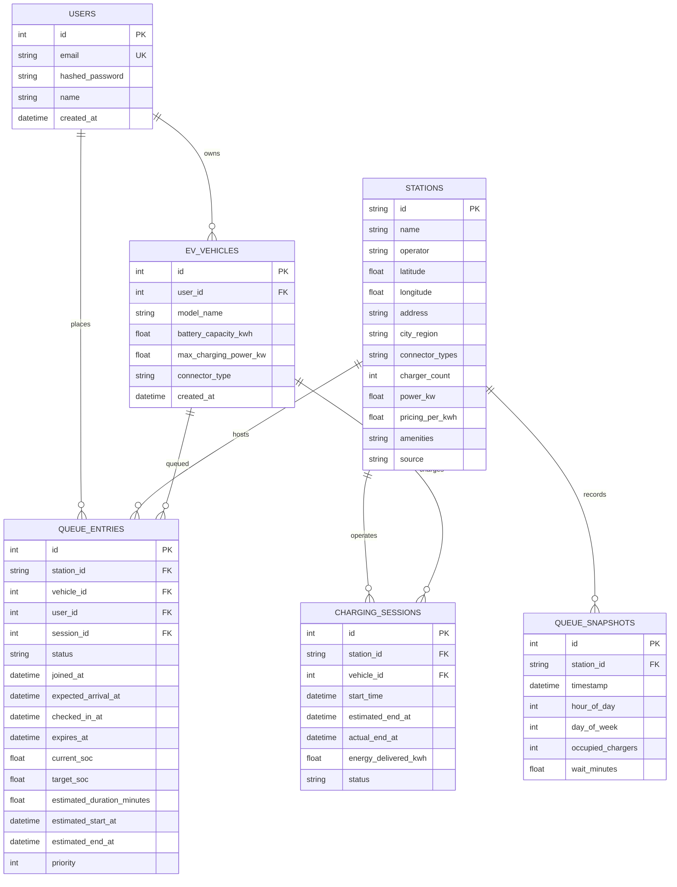
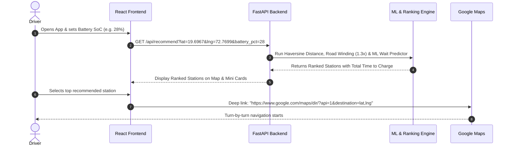
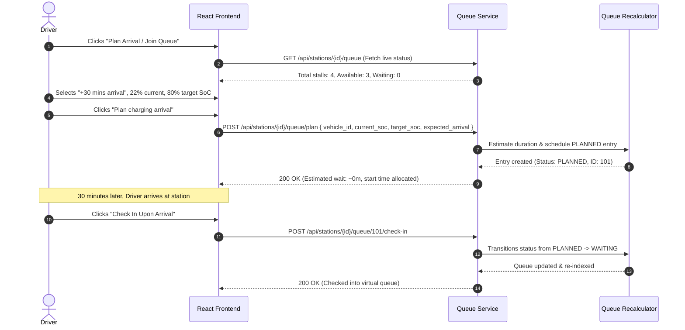

# IntelliCharge ⚡ — Comprehensive Project Documentation & Architecture Guide

> **AI-Powered Smart EV Charging Network with Predictive Queue Estimation, Intelligent Multi-Factor Routing & Virtual Queue Management**

---

## 📋 Table of Contents
1. [Executive Summary & Motivation](#1-executive-summary--motivation)
2. [Key Differentiators & Core Problems Solved](#2-key-differentiators--core-problems-solved)
3. [System Architecture](#3-system-architecture)
4. [Core Features & Technical Modules](#4-core-features--technical-modules)
   - [4.1 Machine Learning Wait-Time Predictor](#41-machine-learning-wait-time-predictor)
   - [4.2 Battery-Aware Reachability & Range Engine](#42-battery-aware-reachability--range-engine)
   - [4.3 Multi-Factor Intelligent Station Ranking](#43-multi-factor-intelligent-station-ranking)
   - [4.4 Smart Virtual Queue Management](#44-smart-virtual-queue-management)
   - [4.5 AI Co-Pilot Reasoning Agent](#45-ai-co-pilot-reasoning-agent)
   - [4.6 Interactive Web Dashboard & Live Map](#46-interactive-web-dashboard--live-map)
5. [Database Schema & Data Models](#5-database-schema--data-models)
6. [API Endpoints & Workflow Reference](#6-api-endpoints--workflow-reference)
   - [Auth Endpoints](#auth-endpoints)
   - [EV Profile Endpoints](#ev-profile-endpoints)
   - [Stations & Recommendation Endpoints](#stations--recommendation-endpoints)
   - [Smart Virtual Queue Endpoints](#smart-virtual-queue-endpoints)
   - [AI Agent Endpoints](#ai-agent-endpoints)
   - [Simulation Endpoints](#simulation-endpoints)
7. [End-to-End User Workflows](#7-end-to-end-user-workflows)
   - [Workflow A: Station Discovery & Navigation](#workflow-a-station-discovery--navigation)
   - [Workflow B: Planned Virtual Queue & Arrival Check-in](#workflow-b-planned-virtual-queue--arrival-check-in)
   - [Workflow C: Conversational Agent Diagnosis](#workflow-c-conversational-agent-diagnosis)
8. [Setup, Seeding & Testing Guide](#8-setup-seeding--testing-guide)

---

## 1. Executive Summary & Motivation

Traditional Electric Vehicle (EV) platforms (such as PlugShare, OpenChargeMap, or generic mapping apps) provide static information: station locations, connector types, and occasionally a binary "available / occupied" indicator. 

However, they suffer from three critical blind spots:
1. **The Arrival Gap**: A charger reported "free" while you are 20 minutes away may have a 45-minute queue by the time you arrive.
2. **Straight-Line Distance Fallacy**: Euclidean distance ignores geographical obstacles, terrain, and urban road winding ($1.3\times$ detour factor), leading to stranded EVs.
3. **Ignorance of Battery Telemetry**: Apps fail to factor in whether an EV can physically reach the charger with its current State-of-Charge (SoC), nor how long charging will take given the vehicle's specific power curve and the station's DC capacity.

**IntelliCharge** is designed as a next-generation EV Co-Pilot that combines **machine learning wait-time estimation**, **battery-constrained reachability calculations**, **multi-factor composite ranking**, and a **Smart Virtual Queue** system with **natural-language AI explanations**.

---

## 2. Key Differentiators & Core Problems Solved

| Challenge | Traditional EV Apps | IntelliCharge Solution |
| :--- | :--- | :--- |
| **Queue Visibility** | Static binary status or none | **ML Regressor** predicting arrival wait time based on time-of-day rush curves and diurnal history. |
| **Distance Measurement** | Straight-line Euclidean distance | **Road-Winding Estimation** ($1.3\times$ factor) + average speed travel time modeling. |
| **Battery Safety** | Driver must calculate range manually | **Automated Reachability Filtering**: Stations beyond safe reach ($<10\%$ buffer) are marked unreachable or highlighted as emergency-only. |
| **Station Selection** | Driver guesses based on rating/distance | **Composite Scoring Function**: Combines travel time, wait time, charging duration, and power rating. |
| **Congestion Management** | Physical lines at charging hubs | **Smart Virtual Queue**: Drivers can plan arrivals (15–60 mins ahead) or check into the virtual queue to hold their place. |
| **Driver Interaction** | Dense UI with tables | **Conversational AI Agent**: Explains tradeoffs ("Station A is 3 km farther, but saves 25 minutes of waiting"). |

---

## 3. System Architecture

```mermaid
flowchart TD
    subgraph Frontend["Frontend (React 18 + Vite + TailwindCSS + Leaflet)"]
        UI["Co-Pilot Dashboard & Navbar"]
        Map["Leaflet Map View (MMR / Palghar)"]
        Hub["Smart Station Hub & Bay Matrix"]
        QueueModal["Virtual Queue Modal"]
        Chat["AI Reasoning Co-Pilot Chat"]
        AuthUI["Driver Auth & Session Sync"]
    end

    subgraph Backend["Backend API (FastAPI + Python 3.13)"]
        AuthAPI["/api/auth (JWT Security)"]
        VehicleAPI["/api/vehicles (EV Profiles)"]
        StationAPI["/api/stations (Ingestion & Filters)"]
        RecommendAPI["/api/recommend (Ranking Engine)"]
        QueueAPI["/api/stations/{id}/queue (Virtual Queue Engine)"]
        AgentAPI["/api/agent/query (Reasoning Agent)"]
    end

    subgraph Engine["Business & Algorithmic Engines"]
        ML["ML Wait-Time Predictor (GradientBoosting / Scikit-Learn)"]
        Math["Charging Math & Compatibility Validator"]
        Dist["Haversine & Road-Winding Calculator"]
        Ranker["Multi-Factor Scoring Optimizer"]
        QueueEngine["Queue Recalculation & Scheduler"]
    end

    subgraph DataStore["Data Layer (SQLite + SQLAlchemy ORM)"]
        DB[(intellicharge.db)]
        StationsTable["stations"]
        QueuesTable["queue_entries"]
        SnapshotsTable["queue_snapshots"]
        UsersTable["users"]
        VehiclesTable["ev_vehicles"]
        SessionsTable["charging_sessions"]
    end

    UI --> Backend
    Map --> Backend
    Hub --> Backend
    QueueModal --> QueueAPI
    Chat --> AgentAPI

    RecommendAPI --> Ranker
    RecommendAPI --> Dist
    RecommendAPI --> ML
    QueueAPI --> QueueEngine
    QueueAPI --> Math
    AgentAPI --> Ranker

    Backend --> DB
```



---

## 4. Core Features & Technical Modules

### 4.1 Machine Learning Wait-Time Predictor
- **Location**: `backend/app/ml/`
- **Trained Model**: `GradientBoostingRegressor` (or `RandomForestRegressor`) trained on 75+ days of synthetic diurnal queue records.
- **Features Captured**:
  - `hour_of_day`: Diurnal rush periods (8–11 AM office rush, 5–9 PM evening peak).
  - `day_of_week`: Weekend vs weekday highway travel patterns.
  - `charger_count`: Number of installed charging bays.
  - `power_kw`: Station capacity (higher power clears cars faster).
  - `occupied_chargers`: Current physical occupancy.
- **Accuracy**: Optimized to achieve **Mean Absolute Error (MAE) < 10 minutes** across MMR and Palghar highway hubs.

### 4.2 Battery-Aware Reachability & Range Engine
- **Location**: `backend/app/services/distance.py` & `charging_math.py`
- **Road-Winding Estimation**: Translates GPS coordinates into road distances using a $1.3\times$ winding factor:
  $$\text{Road Distance} = \text{Haversine Distance} \times 1.3$$
- **Vehicle Energy Consumption**: Models typical EV consumption (~$0.15\text{ to }0.20\text{ kWh/km}$) against remaining usable battery capacity:
  $$\text{Range Available} = \frac{\text{Current SoC} - 10\%}{100} \times \text{Battery Capacity (kWh)} \times 6.5\text{ km/kWh}$$
- **Connector Compatibility Matrix**: Validates connector pairing (e.g., `CCS2` vehicle with `CCS2` / `Type 2` station), emitting warnings if an adapter is required or incompatible.

### 4.3 Multi-Factor Intelligent Station Ranking
- **Location**: `backend/app/services/ranking.py`
- **Cost Function Optimization**: Rather than sorting purely by proximity, IntelliCharge evaluates the **Total Time to Charge (TTC)**:
  $$\text{TTC} = \text{Travel Time (mins)} + \text{Predicted Wait Time (mins)} + \text{Charging Duration to Target SoC (mins)}$$
- **Composite Score Formula**:
  $$\text{Score} = w_1 \cdot \text{Travel Time} + w_2 \cdot \text{Predicted Wait} + w_3 \cdot \text{Charging Time} - w_4 \cdot \text{Station Power} + w_5 \cdot \text{Cost}$$
- **Filter Flags**: Filters out unreachable stations when SoC is critically low, and prioritizes ultra-fast DC chargers ($>50\text{ kW}$) when travel time permits.

### 4.4 Smart Virtual Queue Management
- **Location**: `backend/app/api/queue.py` & `backend/app/services/queue_engine.py`
- **Two Queue States**:
  1. `PLANNED`: Driver indicates an expected arrival time in the future (e.g., $+30\text{ mins}$). Included in future demand forecasting, but **does not occupy a physical charger**.
  2. `WAITING`: Driver physically arrives at the station and checks in, entering the active virtual queue.
- **Queue Engine Rules**:
  - **Dynamic Wait Time Estimation**: Estimates wait times using active session remaining times and queue depth.
  - **Auto Recalculation**: When a driver joins, checks in, cancels, or finishes charging, `recalculate_queue` recalibrates estimated start and end times for all waiting drivers.
  - **Type-Safe User Verification**: Supports authenticated users (with isolated data and zero cross-account leakage) and provides seamless fallback for demo/guest sessions.

### 4.5 AI Co-Pilot Reasoning Agent
- **Location**: `backend/app/services/agent_service.py` & `backend/app/api/agent.py`
- **Capabilities**:
  - Answers natural language queries like *"I have 18% battery near Palghar, where should I charge with the lowest wait?"*
  - Automatically parses intent, extracts user constraints (battery, connector, location), invokes ranking tools, and returns structured recommendations with human-readable rationale.
  - Deep-links directly to Google Maps navigation coordinates.

### 4.6 Interactive Web Dashboard & Live Map
- **Location**: `frontend/src/`
- **Components**:
  - `MapView.jsx`: Leaflet map showing charging stations with color-coded markers (green = low wait, yellow = medium, red = congested).
  - `SmartStationHub.jsx`: Real-time dashboard with search, filter chips (Ultra-Fast $\ge150\text{ kW}$, Zero Wait, CCS2), station mini-cards, and charging bay matrices.
  - `VirtualQueueModal.jsx`: Interactive modal to view queue metrics, adjust SoC sliders, pick expected arrival times, and check into the virtual queue.
  - `DriverAuth.jsx`: Driver profile, vehicle telemetry dashboard, and JWT session handling.

---

## 5. Database Schema & Data Models



---

## 6. API Endpoints & Workflow Reference

All endpoints are hosted under prefix `/api` (OpenAPI Swagger UI available at `/docs`).

### Auth Endpoints
| Method | Endpoint | Auth | Description |
| :--- | :--- | :--- | :--- |
| `POST` | `/api/auth/register` | Public | Create new driver account (returns JWT access token). |
| `POST` | `/api/auth/login` | Public | Authenticate driver using email & password. |
| `GET` | `/api/auth/me` | Bearer | Retrieve currently authenticated user profile. |

### EV Profile Endpoints
| Method | Endpoint | Auth | Description |
| :--- | :--- | :--- | :--- |
| `POST` | `/api/vehicles/` | Optional | Save an EV profile (linked to user if token provided, else demo user). |
| `GET` | `/api/vehicles/` | Optional | Get user's vehicles. Automatically provisions default profile if empty. |

### Stations & Recommendation Endpoints
| Method | Endpoint | Auth | Description |
| :--- | :--- | :--- | :--- |
| `GET` | `/api/stations/` | Public | List stations with optional city/region or search filters. |
| `GET` | `/api/stations/nearby` | Public | Query stations within a given radius (km) of lat/lng. |
| `GET` | `/api/stations/{id}` | Public | Detailed station information and real-time status. |
| `GET` | `/api/stations/{id}/predict-wait` | Public | Run ML prediction for wait time at target hour and day. |
| `GET` | `/api/recommend` | Public | Battery-aware multi-factor ranking. Returns ranked list with breakdowns. |

### Smart Virtual Queue Endpoints
| Method | Endpoint | Auth | Description |
| :--- | :--- | :--- | :--- |
| `GET` | `/api/stations/{id}/queue` | Public | Aggregate station queue status (chargers, waiting count, planned count). |
| `POST` | `/api/stations/{id}/queue/plan` | Optional | Create a planned queue request for a future arrival time ($+15\text{ to }60\text{ min}$). |
| `POST` | `/api/stations/{id}/queue/join` | Optional | Check into virtual queue immediately upon physical arrival. |
| `POST` | `/api/stations/{id}/queue/{entry_id}/check-in` | Optional | Transition an existing `PLANNED` request into active `WAITING` queue. |
| `POST` | `/api/stations/{id}/queue/{entry_id}/leave` | Optional | Cancel or leave an active queue request (IDOR protected). |
| `GET` | `/api/stations/queue/my-requests` | Optional | Get all active queue entries for the current driver. |

### AI Agent Endpoints
| Method | Endpoint | Auth | Description |
| :--- | :--- | :--- | :--- |
| `POST` | `/api/agent/query` | Public | Submit natural-language charging question and receive reasoning. |

### Simulation Endpoints
| Method | Endpoint | Auth | Description |
| :--- | :--- | :--- | :--- |
| `POST` | `/api/stations/demo/tick` | Public | Advance simulated time by $X$ minutes for demo testing. |

---

## 7. End-to-End User Workflows

### Workflow A: Station Discovery & Navigation


### Workflow B: Planned Virtual Queue & Arrival Check-in


### Workflow C: Conversational Agent Diagnosis
```mermaid
sequenceDiagram
    autonumber
    actor Driver
    participant Chat as AI Agent Chat UI
    participant AgentService as Agent Service (Backend)
    participant Recommend as Ranking Engine

    Driver->>Chat: "I have 15% battery near SJCEM Palghar. Can I make it to Manor?"
    Chat->>AgentService: POST /api/agent/query { prompt, lat, lng, currentBattery: 15 }
    AgentService->>AgentService: Parse intent: emergency range check
    AgentService->>Recommend: Calculate distance to Manor (road km * 1.3) vs 15% SoC range
    Recommend-->>AgentService: Usable range: 12 km; Manor distance: 18.5 km (Unreachable!)
    AgentService->>Recommend: Query closest safe station
    Recommend-->>AgentService: SJCEM Palghar Campus Hub is 1.2 km away
    AgentService-->>Chat: "Warning: Manor Plaza is 18.5 km away and exceeds your 12 km safe range. Recommend SJCEM Campus Hub (1.2 km away, 0 min wait)."
    Chat-->>Driver: Renders formatted warning with 1-click navigate button
```

---

## 8. Setup, Seeding & Testing Guide

### Prerequisites
- Python 3.11+
- Node.js 18+ and npm
- Git

### 1. Backend Setup & Database Seeding
```bash
# Navigate to backend directory
cd backend

# Install dependencies
python -m pip install -r requirements.txt

# Seed curated MMR/Palghar stations, synthetic queue dataset, and train ML model
python seed_db.py

# Start FastAPI development server
python -m uvicorn app.main:app --reload --port 8000
```
- Interactive API Docs: [http://localhost:8000/docs](http://localhost:8000/docs)
- Health Check: [http://localhost:8000/health](http://localhost:8000/health)

### 2. Frontend Setup
```bash
# Open a new terminal and navigate to frontend directory
cd frontend

# Install Node modules
npm install

# Launch Vite development server
npm run dev
```
- Web Application: [http://localhost:5173](http://localhost:5173)

### 3. Running Automated Tests
```bash
# In the backend directory:
cd backend

# Run the entire test suite (87 tests covering unit, integration, concurrency & security)
python -m pytest

# Run specific virtual queue tests
python -m pytest tests/test_virtual_queue.py

# Run 10-user concurrency and IDOR security tests
python -m pytest tests/test_ten_users.py
```

---

## 9. Key Directory Layout

```text
intillichargee/
├── backend/
│   ├── app/
│   │   ├── api/             # FastAPI route controllers (auth, queue, stations, agent, vehicles)
│   │   ├── core/            # Config, JWT security, and SQLite database session
│   │   ├── ml/              # Model training, feature pipelines, and wait-time predictor
│   │   ├── models/          # SQLAlchemy ORM models (User, Vehicle, Station, QueueEntry, etc.)
│   │   ├── schemas/         # Pydantic validation schemas
│   │   └── services/        # Business logic (ranking, distance, queue engine, simulator)
│   ├── data/                # Raw station datasets and trained .joblib ML models
│   ├── tests/               # Automated test suites (87 passing tests)
│   ├── seed_db.py           # Database seeder & initial ML training script
│   └── requirements.txt     # Python package dependencies
├── frontend/
│   ├── src/
│   │   ├── components/      # UI components (MapView, SmartStationHub, VirtualQueueModal, etc.)
│   │   ├── context/         # AuthContext for session management
│   │   ├── services/        # Fetch API client
│   │   └── utils/           # Station display helpers and range estimators
│   ├── package.json         # Node.js dependencies
│   └── vite.config.js       # Vite configuration
└── INTELLICHARGE_COMPREHENSIVE_GUIDE.md  # Complete project reference (this document)
```
