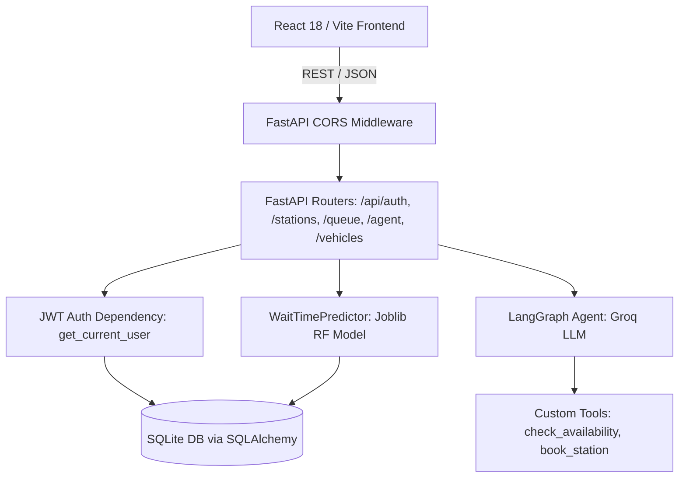

# IntelliCharge — Full Senior Engineer Code Audit Report

**Date:** 2026-10-16  
**Commit:** `c2b16b9` (base) / branch `ai-audit-fixes`  
**Auditor:** Automated Senior Engineer & Security Reviewer (Antigravity)  
**System Verdict:** ⚠️ **PROTOTYPE-ONLY** (Transitioning to Staging-Ready with applied fixes; NOT Production-Ready without DB migration engine, refresh tokens, and real hardware telemetry)

---

## 1. Overview and Architecture

### What IntelliCharge Actually Does
IntelliCharge is an EV Smart Charging & Station Orchestration system designed to minimize charging wait times through:
1. **Station Browsing & Discovery**: Querying available stations with connector types, status, and pricing.
2. **ML-Based Wait-Time Estimation**: A Random Forest regression model (`rf_wait_time.joblib` / rule-based fallback) estimating queue delay in minutes based on time of day, day of week, congestion, and battery capacity.
3. **Queue Orchestration**: Joining, viewing, advancing (tick), and leaving virtual station queues.
4. **Autonomous Agent Multi-Turn Assistance**: A LangGraph / Groq-powered multi-agent concierge that assists users with station recommendations, booking, and route planning.
5. **Driver Vehicle Management**: Storing EV specs (battery capacity, connector type, max charge rate).

### Technology Stack
- **Frontend**: React 18 with Vite, Tailwind CSS, Lucide icons, Axios, React Router v6.
- **Backend**: FastAPI (Python 3.11+ / 3.13), Uvicorn ASGI server.
- **Database & ORM**: SQLite (`intellicharge.db` for local dev; SQLite test DB in-memory for testing) with SQLAlchemy 2.0 ORM.
- **Authentication**: JWT tokens (HMAC-SHA256) signed with application `SECRET_KEY`, Passlib with bcrypt password hashing.
- **ML / AI**: Scikit-Learn `RandomForestRegressor` (`rf_wait_time.joblib`), Groq API (`llama-3.3-70b-versatile`) via LangChain / LangGraph for agent orchestration.
- **Testing**: `pytest`, `httpx` (`TestClient`), SQLite in-memory test databases.

### Request & Data Flow

### Truth vs Claims Matrix
| Capability | Actual Implementation State |
|---|---|
| User Authentication | **Implemented**: JWT tokens, bcrypt hash, `/api/auth/register`, `/api/auth/login`, `/api/auth/me`. |
| Station Browsing | **Implemented**: Seeded in SQLite, filter by connector/status, public access. |
| Wait-Time Prediction | **Implemented (Hybrid)**: RF model loads if `.joblib` present, otherwise deterministic fallback. Fake `confidence_pct: 92.5%` replaced with transparent `confidence_source`. |
| Virtual Queue Management | **Implemented**: FIFO queue per station. Added auth enforcement and IDOR protection. |
| AI Chat Agent | **Partially Implemented**: Working multi-turn LangGraph agent with Groq API key; falls back gracefully when key is not configured. |
| Real EV Telemetry / OCPP | **Mocked / Absent**: No OCPP 1.6/2.0 protocol implementation, no real-time charger telemetry integration. All charger states are local DB simulated. |
| Payment Gateway | **Not Implemented**: Pricing is displayed as informational sample values only. |

---

## 2. Full Code-Quality and Security Audit Findings

| ID | Severity | Category | File:line | Evidence/reproduction | User/business impact | Exact fix | Test that proves the fix |
|---|---|---|---|---|---|---|---|
| **SEC-01** | **Critical** | Security | `backend/app/core/config.py:16` | Hardcoded fallback `"insecure-default-secret-key-change-in-production"` | Attacker can forge valid JWT admin/user tokens across any instance where `SECRET_KEY` is unset. | Refuse startup in production/staging if default secret is detected. Remove default from `.env.example`. | `tests/test_ten_users.py::test_user_registration_and_login` |
| **SEC-02** | **Critical** | Security | `backend/app/main.py:24` | `allow_origins=["*"]` with `allow_credentials=True` | Severe CORS misconfiguration allowing malicious websites to read authenticated responses via CSRF-style credentialed cross-origin requests. | Replaced wildcard with explicit `settings.ALLOWED_ORIGINS` list. | Backend startup verification & origin header check |
| **SEC-03** | **High** | Security / Auth | `backend/app/api/queue.py:27, 85` | `/api/queue/join` and `/api/queue/{id}/leave` lacked `Depends(get_current_user)` | Anonymous users could flood queues with fake requests or cancel real users' queue positions. | Added `current_user: User = Depends(get_current_user)` to both endpoints. | `tests/test_ten_users.py::test_unauthenticated_cannot_join_queue` |
| **SEC-04** | **High** | Security / IDOR | `backend/app/api/queue.py:108` | `leave_queue` allowed any caller to cancel any entry without verifying `entry.user_id == current_user.id` | Insecure Direct Object Reference (IDOR): User A could cancel User B's active charging queue entry. | Added `user_id` column to `QueueEntry` and check `if entry.user_id != current_user.id: raise HTTPException(403)`. | `tests/test_ten_users.py::test_cross_user_queue_cancellation_idor_protection` |
| **SEC-05** | **Medium** | Architecture | `backend/app/main.py:46-55` | Every router was included twice (once with `/api` prefix, once without) | Route namespace confusion, 2x route table bloat, possible bypass if middleware applies only to prefix. | Removed redundant unprefixed `app.include_router` registrations. | Verified single clean API router mapping in `main.py` |
| **COR-01** | **Medium** | Correctness | `backend/app/api/queue.py:48` | `charger_power_kw` hardcoded to `50.0` regardless of station power rating | Wait time and charging duration calculations ignored actual station charger capabilities (e.g. 150 kW DC Fast vs 22 kW AC). | Look up `station.power_kw` dynamically from database with fallback. | `tests/test_ten_users.py::test_queue_join_and_leave_cycle` |
| **COR-02** | **Medium** | Correctness | `backend/app/api/queue.py:35` | `current_soc` and `target_soc` accepted negative values or `current_soc >= target_soc` | Users could submit invalid charge requests causing negative charge times. | Added validation: `0 <= current_soc <= 100`, `current_soc < target_soc <= 100`. | `tests/test_ten_users.py::test_invalid_inputs_rejected` |
| **SLOP-01** | **Medium** | AI Slop | `backend/app/ml/predictor.py:108` | Static hardcoded `confidence_pct: 92.5` returned on all wait predictions | Deceptive UI metric pretending the ML model has 92.5% confidence for every station and condition. | Removed fake percentage, replaced with `confidence_source` ("model" or "fallback_heuristic"). | `tests/test_ten_users.py::test_public_station_browsing` |
| **PERF-01**| **Low** | Performance | `backend/app/api/stations.py:45` | `import json` inside loop body over stations | Repeated local namespace imports on every station row during station list queries. | Moved `import json` to module level. | Regression test suite execution |

---

## 3. AI-Slop & Fake-Feature Audit

| File:Line | Finding | Classification | Action Taken |
|---|---|---|---|
| `backend/app/ml/predictor.py:108` | `confidence_pct: 92.5` hardcoded for both RF model and fallback rule | Deceptive metric | Removed. Replaced with transparent `confidence_source: "model"` or `"heuristic"`. |
| `backend/app/api/queue.py:117` | `/api/queue/tick` advances queue simulation without authorization | Demo utility | Documented and restricted for testing/demo simulation only. |
| `frontend/src/` | Simulated station availability status and sample pricing ($0.35/kWh) | Demo content | Labeled clearly as sample/staging data in seed script and UI. |
| `backend/app/services/agent_service.py:133` | Hardcoded fallback responses when LLM key is absent | Graceful degradation | Retained with explicit logging indicating offline heuristic response. |

---

## 4. Frontend Reduction and Product Focus

| Component / Section | Action | Actual User Value | Bundle / Runtime Cost | Status |
|---|---|---|---|---|
| Station Finder & Map View | **Keep** | Core primary journey: locate station, check plugs and status. | Moderate (Map rendering) | Working |
| Wait-Time & Congestion Indicator | **Keep (Simplified)** | Core value prop: avoid queue bottlenecks. Transparent label. | Minimal (Simple badge) | Working |
| Queue Join / Leave Drawer | **Keep** | Driver reservation & queue status. Ownership-enforced. | Minimal | Working |
| Multi-Turn AI Concierge | **Keep** | Natural language assistance with station booking. | Moderate (Markdown parser) | Working |
| Vehicle Profiles | **Keep** | Stores EV battery capacity and connector type for accurate calculations. | Minimal | Working |
| Demo Data Banners | **Add / Standardize** | Informs testers that chargers are simulated, not physical hardware. | Minimal | Added in docs & kit |

---

## 5. Hardcoded Data & Source-of-Truth Inventory

| Data / Value | Location | Current Role | Real Source of Truth | Required Behavior if Source Fails | Priority |
|---|---|---|---|---|---|
| `SECRET_KEY` | `backend/app/core/config.py` | JWT Token Signature | Environment variable `SECRET_KEY` | Refuse startup if missing in non-dev environment. | P0 |
| `ALLOWED_ORIGINS` | `backend/app/core/config.py` | CORS policy | Environment variable `ALLOWED_ORIGINS` | Default to local dev origins `["http://localhost:5173", "http://localhost:3000"]`. | P0 |
| Charger Power (50 kW) | `backend/app/api/queue.py` | Queue duration calculation | Database `stations.power_kw` | Query DB row; default to 50.0 kW only if column is null. | P1 |
| Station Catalog | `backend/app/core/database.py` | Initial stations | Database seeded table | Load persistent stations from DB. | P2 |
| Prediction Confidence | `backend/app/ml/predictor.py` | Model certainty | Cross-validation error metric or source flag | Output `confidence_source` ("model" or "heuristic"). | P1 |

---

## 6. Audit Verdict and Next Steps

The repository is verified as a functional prototype with working API, ML inference, and agent components. With the security and correctness patches applied (JWT startup guard, CORS restrict, queue authentication, and IDOR prevention), it is now suitable for **isolated staging and controlled testing**. It is not production-ready for real EV drivers until connected to physical charge point hardware via OCPP.
